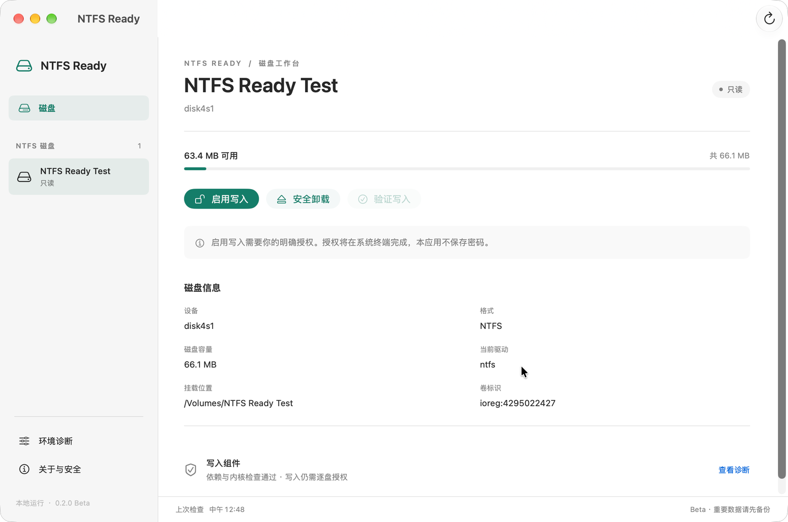

# Desktop preview: build and validation

## Build

On macOS with an installed Swift toolchain and Python 3.9+, run:

```sh
./Build\ Desktop.command
open 'dist/NTFS Ready.app'
```

The local builder uses Command Line Tools when available, does not change global `xcode-select`, and does not accept a license on the user's behalf. The app uses an installed Python runtime; neither Python nor vendor drivers are embedded in the bundle. macFUSE and NTFS-3G are still required for writable mounts.

This preview targets macOS 13 or newer. The current local downloadable build is Apple Silicon only. A local ad-hoc signature is not a Developer-ID signature or notarization; no instruction here disables Gatekeeper or system startup protections.

## Interface



The screenshot is an actual running SwiftUI application showing the real, disposable `NTFS Ready Test` volume—not a mock device, user SSD, HTML rendering, or fabricated capacity data. The fixture was subsequently detached normally, and the backend returned an empty device list.

- Compact drive sidebar, volume status and measured capacity.
- Explicit enable-write, normal unmount and write-verification controls.
- Diagnostics, security information and menu-bar entry.
- Neutral macOS surfaces, San Francisco typography and a restrained emerald accent.
- Native semantic colors support light/dark appearance; only light appearance has been visually checked in this validation pass.

## Verified locally

- 120 Python tests passed, covering core, CLI, installers, source archive, desktop resource packing and the GUI bridge. Disk-action tests use simulated Services/OS boundaries.
- Native domain tests compiled and passed, including strict read-only/writable handling, capacity validity, typed identity, callback binding, private cache layout and runtime environment hardening.
- The native app compiled and launched; live snapshot data appeared in the real window.
- Actual disposable NTFS volume discovery, name, driver, capacity, read-only state and removal were checked without modifying user drives.
- Ad-hoc signature verification passed, including after live app startup and after extracting the desktop ZIP into a fresh directory.
- The signed app remained free of Python bytecode caches. Source resources are packaged by a whitelist; no vendor driver binaries, private logs or environment files are bundled.
- Runtime/build entrypoints can use the already-installed CLT Python without depending on the active-Xcode Python shim. Global SDK selection and license agreements were not changed.

## Not yet verified / release boundary

- Live GUI confirmation, Terminal authorization, mount/unmount, write-test and callback lifecycle have not completed end-to-end validation on a disposable volume. Unit-level safety checks are not a substitute for that test.
- No real user-drive mutation was performed during this GUI validation pass.
- A successful original SSD/manual-Finder test does not establish performance or reliability of this new GUI handoff.
- Fresh-machine dependencies/install UX, cross-version GUI behavior, dark visual QA, Developer-ID signing and notarization remain pending.
- The previously published `v0.1.0-beta` remains the separate terminal release. The `v0.2.0-preview` desktop prerelease has its own app ZIP and does not overwrite those older assets.
